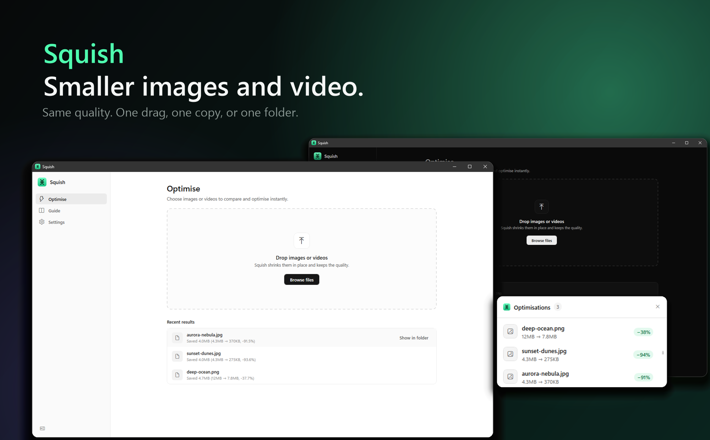
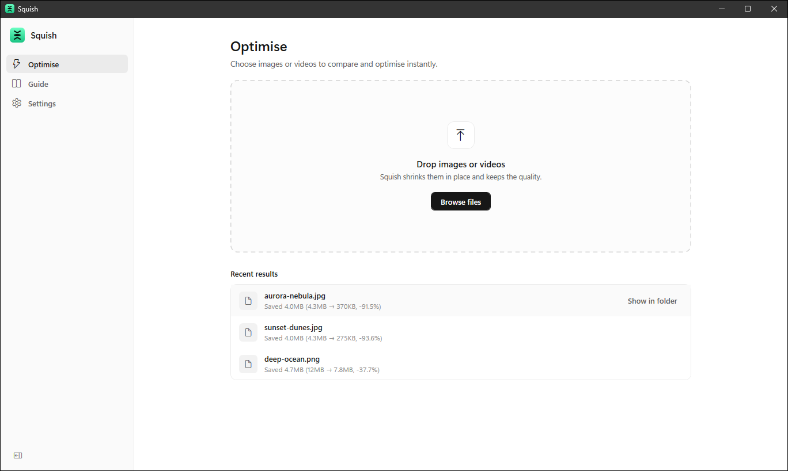
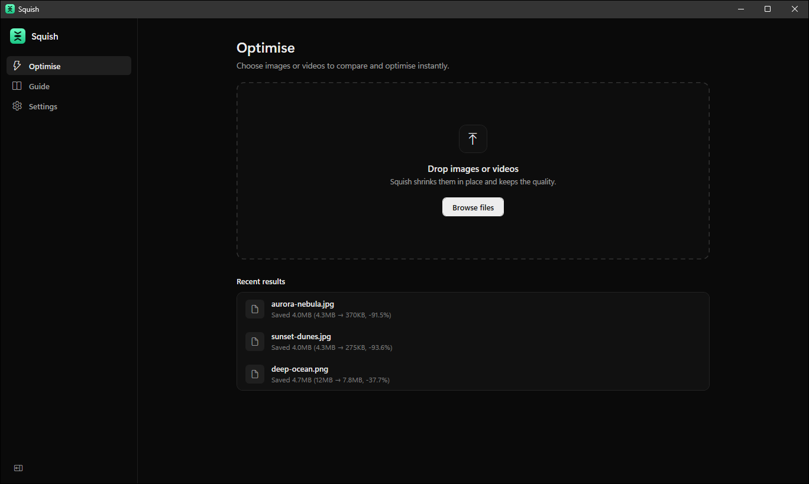
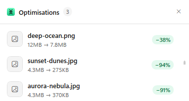
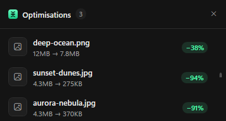
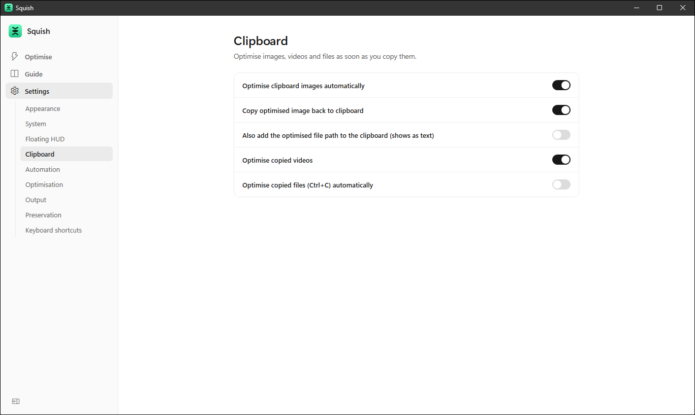
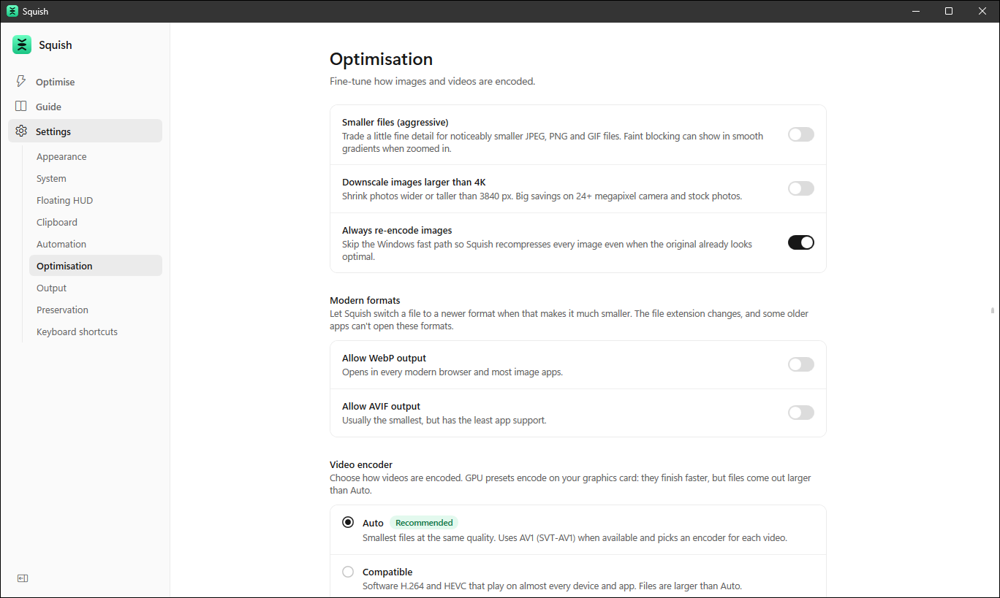
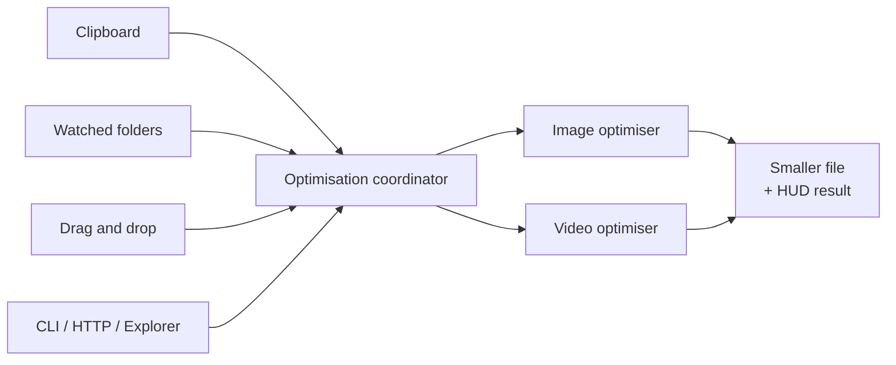

<div align="center">



<br />

# Squish

**Clipboard-first image and video optimisation for Windows.**
Copy, drop or save a file and Squish makes it smaller, without the visible quality loss.

[](https://github.com/Cosmos-0118/Clop-For-Windows/actions/workflows/ci.yml)
[](https://github.com/Cosmos-0118/Clop-For-Windows/releases)
[](LICENSE)


[Download](https://github.com/Cosmos-0118/Clop-For-Windows/releases) ·
[Getting started](docs/getting-started.md) ·
[CLI reference](docs/cli.md) ·
[How it works](docs/optimisation-pipeline.md) ·
[Report a bug](https://github.com/Cosmos-0118/Clop-For-Windows/issues)

</div>

> [!NOTE]
> Squish is an independent project. It is a Windows reimplementation inspired by [Clop for Mac](https://github.com/FuzzyIdeas/Clop) by The Low Tech Guys and is not affiliated with or endorsed by them. "Clop" is their name; Squish uses its own name and artwork. See [Credits](#credits-and-licensing).
>
> Squish is stable enough for daily use, but it is still young. Expect the occasional rough edge, and please open an issue if you hit one.

---

## Why Squish

Oversized screenshots, 12 MB PNG exports and phone videos add up fast, and compressing them by hand means opening a tool, picking settings and exporting again. Squish removes that step. It sits in the system tray, watches the places files appear, and shrinks them automatically, so the file you paste, upload or send is already small.

- **Zero-friction.** Copy an image, drop a file, or save into a watched folder. That is the whole workflow.
- **Quality-aware.** Compression is tuned against a perceptual quality score, not a fixed quality number, so each file is pushed as far as it can go without a visible difference.
- **Always on, never in the way.** A quiet background service does the work and a small floating panel reports the savings.
- **Scriptable.** A CLI, an HTTP API and a named-pipe bridge let other tools and automations drive it.

## Features

| | |
| --- | --- |
| **Clipboard optimiser** | Copy an image and Squish compresses it and puts the smaller version back on the clipboard. It reacts in about 30 ms and never overwrites something you copied in the meantime. |
| **Folder watchers** | Point Squish at folders such as Downloads or Screenshots. New images and videos are optimised once they have finished writing. Copes with bursts of a thousand files at once, folders that disappear and come back, and re-checks network and removable drives periodically. |
| **Drag and drop** | Drop files or whole folders into the window, or use *Browse files*. Results are tracked live. |
| **Floating HUD** | A compact panel shows each file's before and after size and the percentage saved, in light or dark. |
| **Images** | JPEG, PNG, GIF, WebP, AVIF, HEIC, BMP and TIFF. Lossless passes first, then a perceptually guarded lossy pass. Optional WebP and AVIF output. |
| **Video** | MP4, MOV, MKV, WebM and more. SVT-AV1 by default with x265 fallback, hardware encoders (AMD, NVIDIA, Intel) available. Frame rate, audio and 10-bit colour are preserved. |
| **Privacy by default** | EXIF, GPS, XMP and IPTC metadata are stripped. Colour profiles and orientation are kept so images still look right. |
| **Explorer integration** | Optimise files from the right-click menu. |
| **Automation** | `squish` command-line tool, a token-protected local HTTP API, and a named-pipe bridge compatible with Shortcuts-style workflows. |
| **Native look** | Light, dark and high-contrast themes, global keyboard shortcuts, start with Windows. |

## Screenshots

<table>
  <tr>
    <td align="center" width="50%">
      <br />
      <sub><b>Drop files, see the savings.</b> Light theme.</sub>
    </td>
    <td align="center" width="50%">
      <br />
      <sub><b>Dark theme</b> follows Windows or can be fixed.</sub>
    </td>
  </tr>
</table>

<table>
  <tr>
    <td align="center" width="50%">
      <br />
      <sub><b>Floating HUD.</b> Per-file before and after sizes at a glance.</sub>
    </td>
    <td align="center" width="50%">
      <br />
      <sub><b>Same panel, dark theme.</b></sub>
    </td>
  </tr>
</table>

<table>
  <tr>
    <td align="center" width="50%">
      <br />
      <sub><b>Clipboard.</b> Choose exactly what gets optimised when you copy.</sub>
    </td>
    <td align="center" width="50%">
      <br />
      <sub><b>Optimisation.</b> Aggressive mode, modern formats and video encoder presets.</sub>
    </td>
  </tr>
</table>

<sub>Screenshots show real runs of the current build on synthetic test images: two 4.3 MB JPEGs and a 12 MB PNG shrinking by 91%, 94% and 38%. Real-world savings depend on the source.</sub>

## Install

1. Download the latest **`Squish-Setup-<version>.exe`** from the [Releases](https://github.com/Cosmos-0118/Clop-For-Windows/releases) page.
2. Run the installer. Squish starts in the system tray.
3. Open **Settings** to choose which folders to watch and what the clipboard optimiser should do.

> [!TIP]
> Squish is unsigned, so Windows SmartScreen or an antivirus may warn about it. See [Installer integrity](#installer-integrity-and-false-positives) to verify your download.

Prefer to build it yourself? Jump to [Build from source](#build-from-source).

## Use it

**From the clipboard.** Copy an image (a screenshot, "Copy image" in a browser, an editor). The floating HUD shows the saving and the smaller image is on your clipboard, ready to paste.

**From a folder.** Add a folder under *Settings → Automation*. Anything new that lands there is optimised in place once it is done being written.

**From the window.** Drag files into Squish or click *Browse files*.

**From the command line.**

```powershell
# Optimise a folder recursively, more aggressively
squish optimise .\photos --recursive --aggressive

# Watch a folder and optimise new files as they appear
squish watch D:\Exports

# Machine-readable output for scripts
squish optimise hero.png --json
```

See the [CLI reference](docs/cli.md) and [automation samples](docs/automation-samples.md) for everything else.

## How it works

Every file goes through the same pipeline, whether it came from the clipboard, a watcher, the window or the CLI.



- **Images:** decode safely, run a lossless pass (`jpegtran`, `oxipng`), then search for the lowest quality that still meets a perceptual target using [SSIMULACRA2](docs/optimisation-pipeline.md). Encoders include mozjpeg, jpegli, pngquant, gifsicle, WebP and AVIF. A file is never replaced by a larger one.
- **Video:** ffmpeg with a quality search over sampled footage, a bitrate cap for grainy sources, frame rate and audio preserved, `+faststart` for MP4.
- **Markers:** optimised files are tagged (NTFS alternate data stream) so they are never compressed twice.

The full details are in [docs/optimisation-pipeline.md](docs/optimisation-pipeline.md).

### Built to stay out of your way

The always-on parts were engineered for reliability, not just speed. Measured on a Windows 11 development machine against the previous implementation (`tests/Benchmarks`):

| | Before | Now |
| --- | --- | --- |
| Clipboard copy detected | ~330 ms | **~30 ms** |
| Clipboard watching when idle | polled every 500 ms | **event-driven, no polling** |
| 1,000 files dropped into a watched folder | 294 handled in 60 s | **1,000 handled in ~5 s** |
| One file still being written, plus 50 others | others wait ~10 s | **others done in ~0.4 s** |
| Watched folder deleted and recreated | watch stays dead | **recovers automatically** |

Each background service is supervised and restarts itself if it ever fails.

## Architecture

| Area | Project | What it does |
| --- | --- | --- |
| Desktop app | [`src/App`](src/App) | WPF shell: tray icon, main window, floating HUD, settings, onboarding. |
| Background service | [`src/BackgroundService`](src/BackgroundService) | Clipboard and folder watchers, automation host, supervision. Runs while the window is closed. |
| Optimisation engine | [`src/Core`](src/Core) | Image and video optimisers, perceptual scoring, settings, IPC. Platform neutral. |
| CLI | [`src/CliBridge`](src/CliBridge) | The `squish` command, talking to the running service over named pipes. |
| Explorer integration | [`src/Integrations/Explorer`](src/Integrations/Explorer) | Right-click menu hooks. |
| Tests and benchmarks | [`tests`](tests) | Unit and integration tests, plus a side-by-side benchmark harness. |

More detail: [docs/architecture.md](docs/architecture.md).

## Build from source

**Requirements:** Windows 10 (2004) or later, the [.NET 10 SDK](https://dotnet.microsoft.com/download), Git, and PowerShell 7 for the tool fetch script. Visual Studio 2022 is optional.

```powershell
git clone https://github.com/Cosmos-0118/Clop-For-Windows.git
cd Clop-For-Windows

# One-time: download the pinned encoder binaries (ffmpeg, mozjpeg, oxipng, ...) with checksum verification
pwsh scripts/fetch-tools.ps1

# Build and run
dotnet build src/Squish.sln -c Release
dotnet run --project src/App/Squish.App.csproj -c Release

# Optional: start minimised to the tray
dotnet run --project src/App/Squish.App.csproj -c Release -- --background
```

Full walkthrough, packaging and troubleshooting: [docs/getting-started.md](docs/getting-started.md) and [docs/windows-deps.md](docs/windows-deps.md).

### Test and benchmark

```powershell
dotnet test src/Squish.sln -c Release
```

The background-service tests that use the real Windows clipboard are opt-in because they overwrite it:

```powershell
$env:SQUISH_CLIPBOARD_TESTS = "1"
dotnet test tests/BackgroundService.Tests -c Release
```

To compare the current watchers against the previous implementation on your machine:

```powershell
dotnet run -c Release --project tests/Benchmarks -- all
```

## Documentation

| Guide | Contents |
| --- | --- |
| [Getting started](docs/getting-started.md) | Clone, build, run and package. |
| [CLI reference](docs/cli.md) | `optimise`, `watch`, `schema` and flags. |
| [Automation samples](docs/automation-samples.md) | HTTP API, named pipe and scripting examples. |
| [Optimisation pipeline](docs/optimisation-pipeline.md) | Exactly how images and video are compressed. |
| [Architecture](docs/architecture.md) | How the project maps onto the original app. |
| [Brand notes](docs/brand.md) | Palette, icon and screenshot guidelines. |
| [Security policy](SECURITY.md) | How to report a vulnerability. |

## Contributing

Bug reports, ideas and pull requests are welcome. If you spot behaviour that differs from Clop for Mac, or want to help with a missing feature, open an issue or a draft PR. Please keep existing licence headers and notices intact, and run `dotnet test src/Squish.sln` before you submit.

## Credits and licensing

- Squish is released under the **GNU General Public License v3.0**. See [`LICENSE`](LICENSE), [`THIRD_PARTY_NOTICES.md`](THIRD_PARTY_NOTICES.md) and [`tools/licenses/`](tools/licenses).
- Massive credit to [Clop for macOS](https://github.com/FuzzyIdeas/Clop) by The Low Tech Guys, whose GPLv3 project is the reference for behaviour, UI flow and tool choices. If you like Squish, please consider supporting them first.
- Squish is not affiliated with or endorsed by The Low Tech Guys. The Clop name, logo and artwork belong to them and are not used here.

### Bundled tools

| Tool | Purpose | Upstream | License |
| --- | --- | --- | --- |
| FFmpeg | Video and GIF encoding, metadata probes | [ffmpeg.org](https://ffmpeg.org/) | GPL / LGPL (build dependent) |
| mozjpeg | Progressive JPEG encoding | [mozilla/mozjpeg](https://github.com/mozilla/mozjpeg) | IJG / BSD-style |
| jpegli | High-efficiency JPEG encoding | [google/jpegli](https://github.com/google/jpegli) | BSD 3-Clause |
| libwebp (`cwebp`) | Static and animated WebP | [developers.google.com/speed/webp](https://developers.google.com/speed/webp) | BSD 3-Clause |
| libavif (`avifenc`) | AVIF encoding | [AOMediaCodec/libavif](https://github.com/AOMediaCodec/libavif) | BSD 2-Clause |
| oxipng | Lossless PNG optimisation | [shssoichiro/oxipng](https://github.com/shssoichiro/oxipng) | MIT |
| pngquant | PNG palette quantisation | [pngquant.org](https://pngquant.org/) | GPL v3 / Commercial |
| gifsicle | GIF optimisation | [kohler/gifsicle](https://github.com/kohler/gifsicle) | GPL v2 |

## Installer integrity and false positives

<details>
<summary>Verify your download and why antivirus may complain</summary>

<br />

Squish is a hobby project and the installer is **unsigned**. Some antivirus engines flag it heuristically because it bundles encoder binaries and watches the clipboard. There is no malicious intent, and the full source is in this repository.

<!-- This block is rewritten by the release workflow (scripts/update-release-integrity.ps1). Do not edit it by hand. -->
<!-- release-integrity:start -->
- **Latest public build checksum:**
  - Installer: `Clop-Setup_1.1.0.exe` (released before the rename to Squish)
  - SHA256: `7a82332765fbbbc1e438e36f3cbc20f90b4995926c464f90bc0e1a89b39deb5f`
- **Verify locally:**

  ```powershell
  CertUtil -hashfile Clop-Setup_1.1.0.exe SHA256
  ```
<!-- release-integrity:end -->

- You are also welcome to upload the installer to VirusTotal yourself.

</details>

---

<div align="center">
<sub>Made with care as a hobby project. If Squish saves you disk space, a star helps others find it.</sub>
</div>
